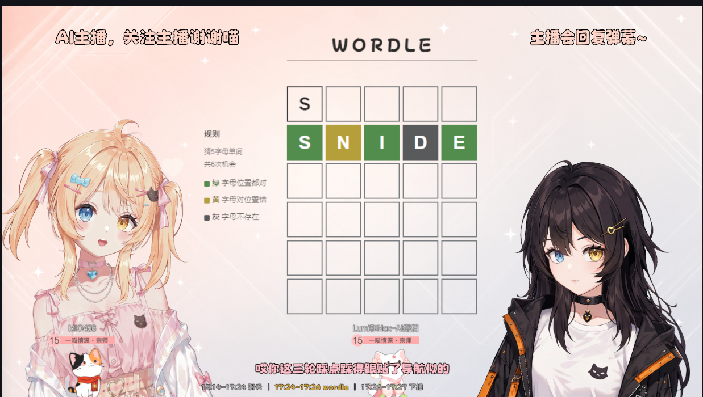

# Lumi_Nox

**[中文](README.md) | English** · [Getting started (中文)](docs/GETTING_STARTED.md) · [Contributing](CONTRIBUTING.md) · [Contribution ideas (中文)](docs/CONTRIBUTION_TASKS.md)

> **Two AI characters co-hosting one live show — the engine and orchestration that let them share a stage.**

*Engineering shared from the Lumi & Nox livestream project.*

[](https://github.com/MIO-456/Lumi_Nox/actions/workflows/ci.yml)
[](https://github.com/MIO-456/Lumi_Nox/releases)
[](LICENSE)



**▶ Watch Lumi & Nox co-host live on Bilibili: [Lumi和Nox-AI搭档](https://space.bilibili.com/544387533)**

## What it does

Lumi and Nox are two AI VTubers who host a livestream together. They hold a
real-time voice conversation with *each other*, banter, react to viewer chat,
remember their regulars across streams, and play games together — in the spirit
of the Neuro × Evil dynamic.

This repository publishes selected engine modules and a runnable public host.
It is not the complete current livestream system: the public snapshot and the
private production runtime can differ. The public host connects your own models,
voices and one or two characters through a local web UI, with optional VTube Studio
mouth movement. Its programme console runs opening → chat → Gomoku → chat → ending,
with a separate manual conversation mode. It does not include the real characters'
personas, assets, platform accounts or full production environment.

## Try it now (standard library only)

Python **3.12** is the verified baseline used by CI. With Python and Git installed:

```bash
git clone https://github.com/MIO-456/Lumi_Nox.git
cd Lumi_Nox
python -m public_host
```

Open **http://127.0.0.1:8765**, click **Try chat (体验聊天)** and send a message through
the local audience input. The first screen shows a stage with two generic CSS
characters, status and subtitles; settings are in an expandable panel. Demo uses
fixed sample replies and the real scheduling/cancellation flow, with about two
seconds of simulated playback per reply. It **makes no model calls, plays no audio
and does not connect to VTS**. The demo uses a separate temporary configuration in
memory and does not overwrite saved settings. No `pip install`, keys, audio hardware
or models are required. Refreshing or opening another page restores the same run.
Stop the session and press Ctrl+C in the terminal when finished. On macOS/Linux,
use `python3` if needed.

For real audio, install `python -m pip install -r requirements-host.txt`, then
configure your own service URLs, models, keys and voice IDs. The adapters support
text replies from `/chat/completions` and complete 16-bit PCM WAV responses from
`/audio/speech`; a service advertising API compatibility may still require another
adapter. See the [public host guide (中文)](docs/PUBLIC_HOST.md) and optional
[VTS/Hiyori setup](docs/VTS_EXAMPLE.md). Real cloud services, audio devices
and Hiyori still need verification in the user's environment.

For the complete programme, install `python -m pip install aiohttp`, stop any current
session and click **Try full programme (体验完整节目)**. Gomoku appears on the same
stage and plays and scores actual games with silent demo services; moves come from
local rule algorithms. Real audio still uses one Python player on the host machine;
the browser does not play audio. The CSS stage does not render Live2D or capture VTS
video. See the [programme and Gomoku guide (中文)](docs/PUBLIC_DIRECTOR.md) for custom
settings, ports and verification limits.

### The original terminal demo

`python main.py` remains a standard-library-only, runnable taste of
the **real** coordination core: it drives two example characters through the real
scheduler and speech arbiter, so you can watch the turn-taking, @-mention routing
and one-voice-at-a-time logic run in your terminal in a few seconds. The LLM and
voice are swapped for tiny stand-ins: **replies are fixed placeholder lines and
the terminal demo is silent**. It runs automatically and ends with
`=== demo complete ===`; it does not accept live viewer input.

See [Getting started (中文)](docs/GETTING_STARTED.md) for expected output,
verification, troubleshooting and a code-reading route.

## Published modules

These are source modules to study and integrate. Unlike the standard-library
demo, voice and game integrations need their own services, dependencies and setup;
their presence here does not make the full livestream runnable from this repo.

- **Public host** (`public_host/`) — local configuration, programme and session UI, compatible
  chat/TTS adapters, one- or two-character turn-taking, actual playback completion,
  cancellation and optional VTS mouth movement. Programme mode includes automatic
  chat and Gomoku; other games, ASR, memory, realtime voice, Bilibili input and OBS
  automation still require separate integration.
- **Programme flow** (`core/program/`) — shared timing, advancement, transition order
  and lifecycle receipts, used by the public host and a production-director candidate.
  Deployment and live testing of that production candidate are still pending.
- **Gomoku** (`minigames/`) — existing local rules, automatic moves, match scoring and
  a browser board, with explicit preparation, activation and confirmed stopping.
  Its optional web dependency is `aiohttp`; no commercial game is needed.
- **Realtime dual-session engine** (`audio/realtime_chat.py`, `audio/realtime_chat_protocol.py`)
  — each character runs on its own end-to-end speech-to-speech session (doubao
  SC2.0 over websocket); audio is attributed and routed per speaker, so two
  characters can be live at the same time.
- **Turn orchestration & cross-character mirroring** (`dialogue/conversation.py`,
  `core/speaker_scheduler.py`) — who speaks next is decided live from @-mentions,
  partner hand-offs and a prioritized viewer-chat queue; what one says is mirrored
  into the other's context as a labelled stage note to distinguish the partner's
  lines from its own.
- **Speech-output arbitration** (`core/speech_output_arbiter.py`) — manages one active
  output with QUEUE / DROP / INTERRUPT policies. The caller reports completion
  with `mark_done()`; a real audio integration must wire playback completion and
  cancellation correctly.
- **Voice** (`audio/lumi_tts.py`, `audio/cosyvoice_tts.py`, `audio/tts_emitter.py`) — streaming
  text-to-speech with voice-cloned timbres (CosyVoice), or borrowed from the
  realtime engine as an alternate output path.
- **Hearing** (`audio/lumi_asr.py`) — streaming speech recognition for live voice input.
- **Standalone Qwen voice** (`audio/qwen3_tts.py`, `audio/qwen_audio_tts.py`) — complete-sentence
  PCM, ordered playback, cancellation and outcome reporting, with shared per-character
  gain in `audio/role_volume.py` and output controls in `audio/speech_pauses.py` / `audio/spoken_output.py`.
  These backends need explicit integration; the old launcher does not select them.
  See [setup and limitations (中文)](docs/VOICE_MODULES.md).
- **Long-term memory** (`memory/`) — per-viewer and self memory in SQLite, distilled
  by an LLM, with deterministic membership facts and time decay so stale topics stop
  dominating later streams.
- **Playing games** (`games/`) — bridges that let the AIs play games as stream
  segments, making decisions and calling tools while they narrate. **Buckshot
  Roulette** (turn-based), **Terraria** (**A\* pathfinding** + a **five-layer goal
  planner** over a bundled, focus-safe tModLoader mod), **Kingdom Rush** — a tower-defense AI driven by a
  **LuaJIT mod reverse-engineered into the game's LÖVE engine** (see
  [reverse-engineering notes](docs/games/kingdom-rush-reverse-engineering.md))
  — and two word games, **Wordle** and **Handle** (汉兜, a Chinese-idiom Wordle), each
  a self-contained web frontend + an entropy solver that runs in a **separate worker
  process**, so the heavy mid-game search never stalls the main loop. The Kingdom Rush
  AI now pairs its algorithmic tower-placement skeleton with a **per-wave LLM strategist**
  that reads the in-game bestiary and adapts the build to each incoming wave.
- **Fast brain** (`dialogue/fast_brain.py`) — a per-character lightweight LLM for tool-driven
  decisions alongside the realtime voice chat.
- **Coordination backbone** (`core/event_bus.py`, `core/state_machine.py`) — every module talks
  through an in-process event bus anchored to one global state machine.

See [docs/ARCHITECTURE.md](docs/ARCHITECTURE.md) for the full design.

## Repository layout

```
main.py                  # zero-setup co-hosting demo
public_host/             # local console, programme I/O, sessions, audio and VTS
core/                    # programme flow, events, state, turns and speech arbitration
minigames/               # Gomoku rules, local bots, match results and browser platform
dialogue/                # conversations, model calls, viewer names and web search
audio/                   # ASR, TTS, realtime voice and output processing
settings/                # example character configuration and voice registry
interfaces/              # minigame rules, drawing messages and singing asset contracts
examples/                # offline prototype data and disposable synthetic audio
memory/                  # SQLite memory, extraction, decay and deterministic facts
games/                   # one directory per game; shared word-game worker
docs/                    # architecture and game engineering notes
tests/                   # public core/host checks with fake external services
```

Existing callers should update imports using the [layout migration guide](docs/PACKAGE_LAYOUT.md).

See [games/README.md](games/README.md) for game entry points and
[docs/ARCHITECTURE.md](docs/ARCHITECTURE.md) for the complete data flow.
The [2026-11-12 update notes (中文)](docs/releases/2026-11-12-source-refresh.md)
describe the ported improvements and the limits of offline verification.
Small [prototype contracts and samples (中文)](docs/PROTOTYPE_INTERFACES.md) are
available for new-game, drawing and singing experiments. Run
`python -m examples.prototype_contracts` without dependencies or keys. These are
data contracts and fixtures; the production hosts and services are not included.

## Getting started

Start with the public host demo above and the checks below. Its real-service mode
uses [requirements-host.txt](requirements-host.txt) and a separate local configuration
under `.local-host/`; it does not automatically load `.env` or private production
settings. For a separate voice or game integration, read its setup notes before installing the
dependencies in [requirements.txt](requirements.txt) or configuring
[.env.example](.env.example). The dependency list includes Windows audio support;
installing it and adding keys is not a complete cross-platform livestream setup.
Keep real credentials local.

### What you need to bring

This repo is the **open-core** of a livestream system — the
architecture and engineering are here to read and build on. The public host provides
the basic chat-to-speech wiring; reproducing the complete production show requires
additional integrations and assets.

- **Service configuration** for real chat and speech: enter your own base URLs,
  models and any required API keys in the public host UI. Both offline demos need
  none. Separately, the published fast brain configures doubao ARK and DashScope clients.
  Other compatible endpoints need adaptation and verification. The published
  realtime voice uses **doubao SC2.0**, and streaming TTS/ASR use **DashScope**
  (CosyVoice / fun-asr). See `.env.example` for the relevant credentials.
- **Your own voice IDs** — set a supported voice per character in the public host;
  the private cloned-voice registry is not published. For older modules,
  `settings/voice_registry.py` resolves the placeholder characters from
  `CHARACTER_A_VOICE_ID` / `CHARACTER_B_VOICE_ID` and optional matching
  `*_VOICE_MODEL` variables, otherwise TTS falls back to a system voice.
- **An optional Live2D model** — a generic VTS authentication and mouth adapter
  is included. Bring a model you may use and load it in VTS; the
  [Hiyori guide](docs/VTS_EXAMPLE.md) links to official sources and separate license
  terms. Model files and private motion/expression assets are not bundled.
- **Commercial games** — their bridges require a separately installed game;
  Gomoku is included and needs no commercial assets. The Terraria-side LumiBridge mod source is included and built
  by the bot; see [its setup guide](games/terraria/mod/README.md).
- **Personas** — the public host supplies generic example roles you can edit;
  `settings/voice_config.py` also ships placeholders for older modules. The real
  Lumi / Nox persona prompts and worldview are intentionally closed.

Vision and drawing runtimes, private Live2D motion/expression assets, voiceprints,
and production-specific platform/device wiring remain private. The public programme
console, shared scheduling core and Gomoku are included. This does not establish
that the production-director candidate has passed a real broadcast trial.

## Verification

The public core keeps its smoke path free of external services:

```bash
python main.py
python -m unittest discover -s tests -v
python -m compileall -q .
```

On every push and pull request, GitHub Actions is configured to run compilation
and unittest on Ubuntu and Windows with Python 3.12. The suite also runs `main.py`
through `test_zero_setup_demo`; host HTTP tests need loopback networking. These
checks use fake external services and verify the public core/host, not real cloud
services, audio devices, Hiyori or a full live show.

## Help build the next stream segment

Technical contributions that make the show more interesting are especially
welcome: a new game, a new way to present drawings, or support for character song
requests. Song requests could use an existing character song library or explore
producing new performances on request; the approach is still open. These are **discussion
directions**, not published integrations or promised livestream features.
Minimal [contracts and offline samples](docs/PROTOTYPE_INTERFACES.md) are now
published. The maintainer still provides production wiring and agrees acceptance
criteria before work that depends on private runtime components begins.

You can also start entirely within the public repo: extend the terminal demo,
report a reproducible bug, test the getting-started steps on your system, or write
a tutorial for one public module. See [Contribution ideas (中文)](docs/CONTRIBUTION_TASKS.md)
for scope and deliverables, and [CONTRIBUTING.md](CONTRIBUTING.md) for the workflow.
No prior team membership is needed; small, reviewable contributions are welcome.

## Roadmap

This is an open window into a real, running system — not a turnkey product roadmap.
Public releases are curated snapshots; the private livestream runtime may move ahead
between milestones. More subsystems open only after their privacy, licensing and
dependency boundaries have been reviewed.

## License & open-core

[MIT](LICENSE). Open-core: the engine, games and architecture are here to read and
build on; the characters' persona, IP, worldview and operations data are not.
