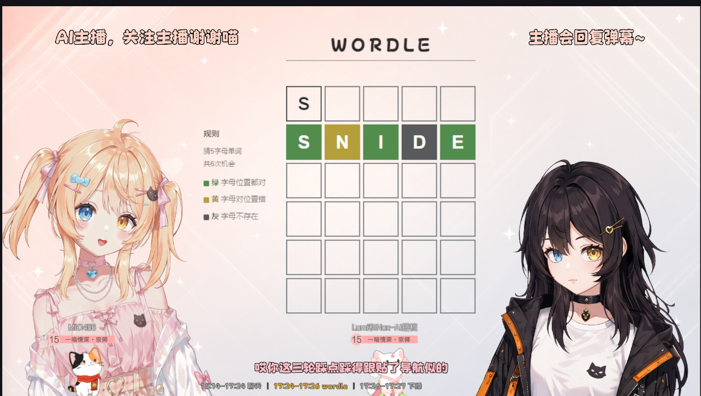

# Lumi_Nox

**[中文](README.md) | English** · [Getting started (中文)](docs/GETTING_STARTED.md) · [Contributing](CONTRIBUTING.md) · [Contribution ideas (中文)](docs/CONTRIBUTION_TASKS.md)

> **Two AI characters co-hosting one live show — the engine and orchestration that let them share a stage.**

*Engineering shared from the Lumi & Nox livestream project.*

[](https://github.com/MIO-456/Lumi_Nox/actions/workflows/ci.yml)
[](https://github.com/MIO-456/Lumi_Nox/releases)
[](LICENSE)



**▶ Watch Lumi & Nox co-host live on Bilibili: [Lumi和Nox-AI搭档](https://space.bilibili.com/544387533)**

## What it does

Lumi and Nox are two AI VTubers who host a livestream together. They hold a
real-time voice conversation with *each other*, banter, react to viewer chat,
remember their regulars across streams, and play games together — in the spirit
of the Neuro × Evil dynamic.

This repository publishes selected engine modules and a small runnable demo.
It is not the complete current livestream system: the public snapshot and the
private production runtime can differ. The demo below does not reproduce the
full show or include the real characters' personas and voices.

## Try it now (standard library only)

Python **3.12** is the verified baseline used by CI. With Python and Git installed:

```bash
git clone https://github.com/MIO-456/Lumi_Nox.git
cd Lumi_Nox
python main.py
```

On macOS/Linux, use `python3` if that is your Python 3.12 command. No `pip install`,
API keys, audio hardware or models are required for this demo. `main.py` is a runnable taste of
the **real** coordination core: it drives two example characters through the real
scheduler and speech arbiter, so you can watch the turn-taking, @-mention routing
and one-voice-at-a-time logic run in your terminal in a few seconds. The LLM and
voice are swapped for tiny stand-ins: **replies are fixed placeholder lines and
the terminal demo is silent**. It runs automatically and ends with
`=== demo complete ===`; it does not accept live viewer input.

See [Getting started (中文)](docs/GETTING_STARTED.md) for expected output,
verification, troubleshooting and a code-reading route.

## Published modules

These are source modules to study and integrate. Unlike the standard-library
demo, voice and game integrations need their own services, dependencies and setup;
their presence here does not make the full livestream runnable from this repo.

- **Realtime dual-session engine** (`realtime_chat.py`, `realtime_chat_protocol.py`)
  — each character runs on its own end-to-end speech-to-speech session (doubao
  SC2.0 over websocket); audio is attributed and routed per speaker, so two
  characters can be live at the same time.
- **Turn orchestration & cross-character mirroring** (`conversation.py`,
  `speaker_scheduler.py`) — who speaks next is decided live from @-mentions,
  partner hand-offs and a prioritized viewer-chat queue; what one says is mirrored
  into the other's context as a labelled stage note to distinguish the partner's
  lines from its own.
- **Speech-output arbitration** (`speech_output_arbiter.py`) — manages one active
  output with QUEUE / DROP / INTERRUPT policies. The caller reports completion
  with `mark_done()`; a real audio integration must wire playback completion and
  cancellation correctly.
- **Voice** (`lumi_tts.py`, `cosyvoice_tts.py`, `tts_emitter.py`) — streaming
  text-to-speech with voice-cloned timbres (CosyVoice), or borrowed from the
  realtime engine as an alternate output path.
- **Hearing** (`lumi_asr.py`) — streaming speech recognition for live voice input.
- **Long-term memory** (`memory/`) — per-viewer and self memory in SQLite, distilled
  by an LLM, with deterministic membership facts and time decay so stale topics stop
  dominating later streams.
- **Playing games** (`games/`) — bridges that let the AIs play games as stream
  segments, making decisions and calling tools while they narrate. **Buckshot
  Roulette** (turn-based), **Terraria** (**A\* pathfinding** + a **five-layer goal
  planner** over a bundled, focus-safe tModLoader mod), **Kingdom Rush** — a tower-defense AI driven by a
  **LuaJIT mod reverse-engineered into the game's LÖVE engine** (see
  [reverse-engineering notes](docs/games/kingdom-rush-reverse-engineering.md))
  — and two word games, **Wordle** and **Handle** (汉兜, a Chinese-idiom Wordle), each
  a self-contained web frontend + an entropy solver that runs in a **separate worker
  process**, so the heavy mid-game search never stalls the main loop. The Kingdom Rush
  AI now pairs its algorithmic tower-placement skeleton with a **per-wave LLM strategist**
  that reads the in-game bestiary and adapts the build to each incoming wave.
- **Fast brain** (`fast_brain.py`) — a per-character lightweight LLM for tool-driven
  decisions alongside the realtime voice chat.
- **Coordination backbone** (`event_bus.py`, `state_machine.py`) — every module talks
  through an in-process event bus anchored to one global state machine.

See [docs/ARCHITECTURE.md](docs/ARCHITECTURE.md) for the full design.

## Repository layout

```
main.py                  # zero-setup co-hosting demo
event_bus.py             # coordination backbone
state_machine.py         # global stream state
speaker_scheduler.py     # turn selection and @-mention routing
speech_output_arbiter.py # one voice holds the floor at a time
conversation.py          # text-pipeline orchestration and history mirroring
realtime_chat*.py        # dual realtime speech-to-speech sessions
lumi_asr.py / lumi_tts.py / cosyvoice_tts.py / tts_emitter.py
memory/                  # SQLite memory, extraction, decay and deterministic facts
games/                   # one directory per game; shared word-game worker
docs/                    # architecture and game engineering notes
tests/                   # zero-dependency public-core checks
```

See [games/README.md](games/README.md) for game entry points and
[docs/ARCHITECTURE.md](docs/ARCHITECTURE.md) for the complete data flow.

## Getting started

Start with the standard-library demo above and the checks below. For a specific
voice or game integration, read its code and setup notes before installing the
dependencies in [requirements.txt](requirements.txt) or configuring
[.env.example](.env.example). The dependency list includes Windows audio support;
installing it and adding keys is not a complete cross-platform livestream setup.
Keep real credentials local.

### What you need to bring

This repo is the **open-core** of a livestream system — the
architecture and engineering are here to read and build on, not a turnkey product.
Running the full thing needs the pieces below: some are yours to bring, some are
intentionally kept closed.

- **API keys** for the model and voice integrations; the `main.py` demo needs
  none. The published fast brain configures doubao ARK and DashScope clients.
  Other compatible endpoints need adaptation and verification. The published
  realtime voice uses **doubao SC2.0**, and streaming TTS/ASR use **DashScope**
  (CosyVoice / fun-asr). See `.env.example` for the relevant credentials.
- **Your own voice IDs** — the private cloned-voice registry is not published.
  `voice_registry.py` resolves the placeholder characters from
  `CHARACTER_A_VOICE_ID` / `CHARACTER_B_VOICE_ID` and optional matching
  `*_VOICE_MODEL` variables, otherwise TTS falls back to a system voice.
- **A Live2D model** — the avatar / motion / expression layer is tied to specific
  character models and is **not** included; bring your own and wire it in.
- **The game** — the game bridge talks to a commercial game over TCP; you supply
  the game itself. The Terraria-side LumiBridge mod source is included and built
  by the bot; see [its setup guide](games/terraria/mod/README.md).
- **Personas** — `voice_config.py` ships placeholder example characters; the real
  Lumi / Nox persona prompts and worldview are intentionally closed.

Vision, drawing, the Live2D motion/expression layer, voiceprints, and the live
director/control console remain in the private production system.

## Verification

The public core keeps its smoke path free of external services:

```bash
python main.py
python -m unittest discover -s tests -v
python -m compileall -q .
```

On every push and pull request, GitHub Actions runs compilation and the unittest
suite on Ubuntu with Python 3.12. The suite also runs `main.py` through
`test_zero_setup_demo`; this verifies the public smoke path, not a full live show.

## Help build the next stream segment

Technical contributions that make the show more interesting are especially
welcome: a new game, a new way to present drawings, or support for character song
requests. Song requests could use an existing character song library or explore
producing new performances on request; the approach is still open. These are **discussion
directions**, not published integrations or promised livestream features.
The maintainer will provide agreed minimal interfaces, samples and acceptance
criteria before work that depends on private runtime components begins.

You can also start entirely within the public repo: extend the terminal demo,
report a reproducible bug, test the getting-started steps on your system, or write
a tutorial for one public module. See [Contribution ideas (中文)](docs/CONTRIBUTION_TASKS.md)
for scope and deliverables, and [CONTRIBUTING.md](CONTRIBUTING.md) for the workflow.
No prior team membership is needed; small, reviewable contributions are welcome.

## Roadmap

This is an open window into a real, running system — not a turnkey product roadmap.
Public releases are curated snapshots; the private livestream runtime may move ahead
between milestones. More subsystems open only after their privacy, licensing and
dependency boundaries have been reviewed.

## License & open-core

[MIT](LICENSE). Open-core: the engine, games and architecture are here to read and
build on; the characters' persona, IP, worldview and operations data are not.
